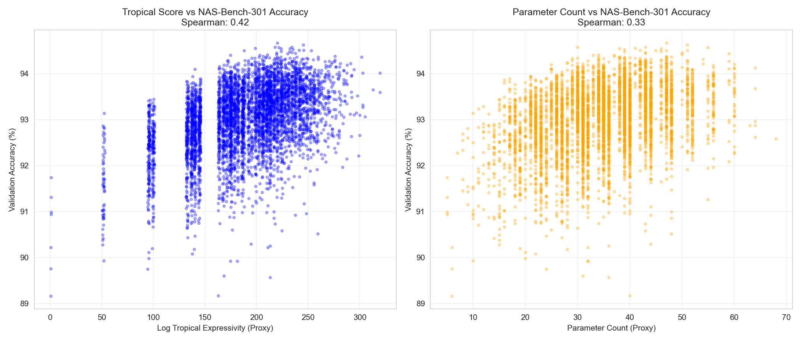
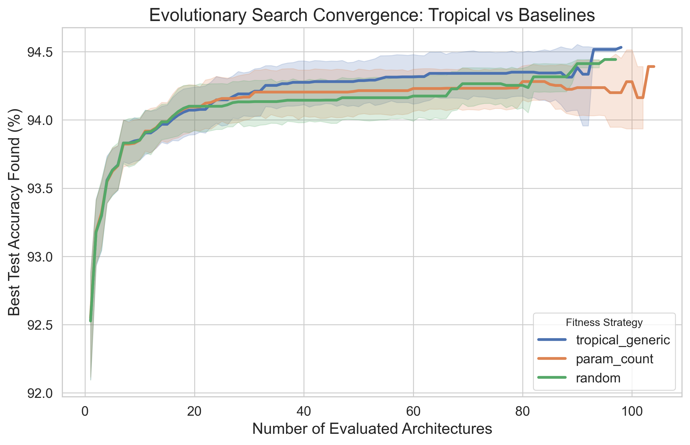
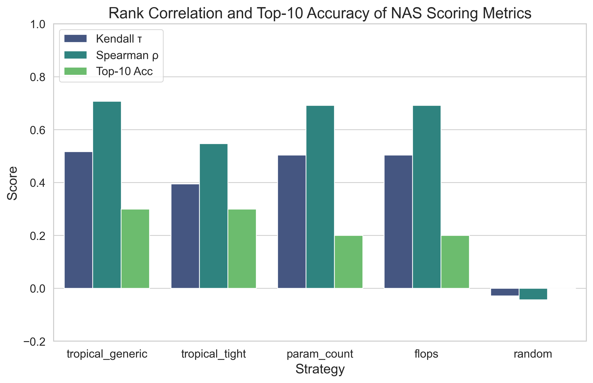
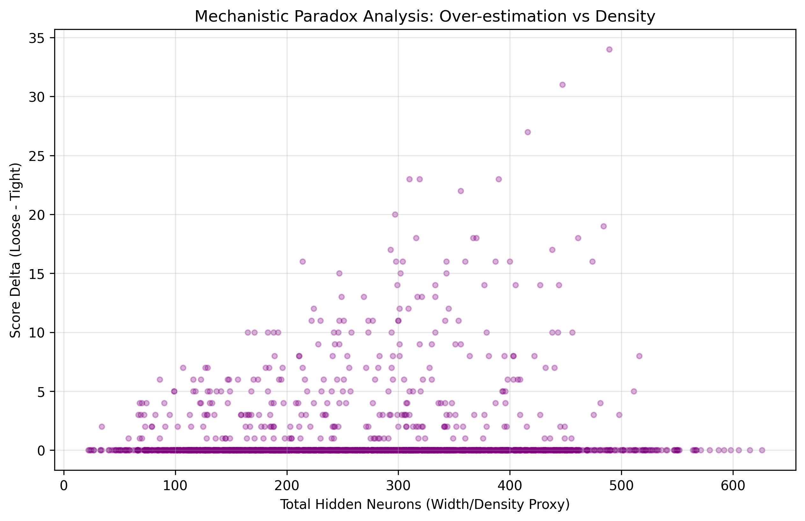

# CANOPY: Tropical-Geometry-Inspired Neural Architecture Search

[](LICENSE)
[](pyproject.toml)
[](https://github.com/CodNoob100/canopy/actions/workflows/python-tests.yml)

CANOPY is **research software** for training-free neural architecture search (NAS). It explores architecture-level combinatorial **upper bounds** on ReLU linear regions and heuristic structural proxies motivated by tropical geometry. An architecture's bound is **not** the number of regions realized by a particular initialized or trained model, nor is it a guarantee of predictive performance.

## Implemented interfaces and evidence

| Interface | What it computes | Interpretation |
| --- | --- | --- |
| `canopy score --widths ... --mode generic|tight` | Integer combinatorial region bound | Architecture-only upper bound (`count_bound`), **not** an exact realized count or log10 value |
| `tropical_expressivity_score_darts(arch)` | Approximate convolution/skip structural score | Heuristic **log10-scale proxy**, not an exact DARTS region count |
| `tropical_expressivity_score(..., mode="weight_aware")` | Counts/estimates for explicitly instantiated weights | Exactness depends on counting method and problem size |
| `canopy evaluate ...` | Retrospective proxy/rank comparisons on a caller-provided NATS-Bench TSS artifact | Requires trusted **real benchmark data**; does not train models |
| `ExperimentRunner` | Seeded search experiments, JSON/CSV and provenance manifests | Synthetic results are labeled simulated and **cannot validate** a proxy |

See [scoring and evaluation CLI documentation](docs/cli.md), [experiment reproducibility](docs/reproducibility.md), and the [research evidence ledger](docs/research-evidence.md) for source locations and validation limits.

## Validation status and historical figures

The GitHub Actions Python test suite and dependency-compatibility smoke tests have passed for the merged code. Those tests use offline fixtures and injected benchmark backends where relevant. **They do not establish any empirical accuracy correlation on a trusted NATS-Bench artifact or NAS-Bench-301 model.** Authentic NATS-Bench integration verification is tracked in [issue #29](https://github.com/CodNoob100/canopy/issues/29).

Earlier versions of this README reported DARTS Spearman rho of **0.51** versus **0.33** for a parameter-count proxy (described as 56% relative improvement). These are **historical project-reported numbers, not independently reproduced results**. This repository does not currently provide a verified benchmark artifact, model/version provenance and run manifest sufficient to substantiate those figures. Treat them as unverified until an auditable replication is available; do not cite them as established findings.

The following checked-in plots are **historical illustrations**. Their presence alone does not establish data provenance, methodology or independent replication:

| Historical DARTS correlation plot | Historical DARTS search trajectory |
|:---:|:---:|
|  |  |

| Historical CIFAR-100 correlation plot | Historical bound-tightness illustration |
|:---:|:---:|
|  |  |

## Install

Python **3.10 or newer** is required. Core dependencies are NumPy (`>=1.24`) and SciPy (`>=1.10`); the version floors are documented in [pyproject.toml](pyproject.toml). The dependency bounds allow newer compatible releases without requiring everyone to upgrade to the newest major version.

```bash
git clone https://github.com/CodNoob100/canopy.git
cd canopy
python -m pip install -e .
```

For NATS-Bench API access, or for evaluation plots and local testing:

```bash
python -m pip install -e '.[bench]'
python -m pip install -e '.[bench,eval,dev]'
```

The optional `torch` and `geometry` extras are defined separately. **NAS-Bench-301** and its surrogate models are **not** installed by `.[bench]` and must be obtained according to the [upstream project](https://github.com/automl/nasbench301) and trusted model-release instructions.

## Quickstart: architecture-only scoring

```bash
canopy score --widths 2,4,1 --mode generic
canopy score --widths 2,4,1 --mode tight --json
```

Width order is **input, zero or more hidden widths, output**. The JSON form writes the potentially large integer score as a **decimal string** and labels its units `count_bound`.

```python
from canopy.nas.architecture import ArchitectureSpec
from canopy.nas.tropical_score import tropical_expressivity_score

architecture = ArchitectureSpec(layer_widths=(32, 64, 128, 64, 10))
bound = tropical_expressivity_score(architecture, mode="generic")
print(f"Architecture-level region upper bound: {bound}")
```

For the research-oriented DARTS structural score, use `tropical_expressivity_score_darts(arch)` with a suitable `ArchitectureSpec.cell_ops`. Its float result is a **log10-scale heuristic proxy** and is **not directly comparable in units** with the integer `generic`/`tight` bounds. See [the implementation](canopy/nas/tropical_score.py).

## Evaluate with trusted real NATS-Bench data

Download the **topology search space (TSS)** artifact from the [official NATS-Bench project](https://github.com/D-X-Y/NATS-Bench), establish its provenance, and point the CLI at the actual *simple* directory or benchmark file. It does not download data or silently fall back to simulated accuracies.

```bash
canopy evaluate \
  --benchmark-data /trusted/path/to/NATS-tss-v1_0-3ffb9-simple \
  --dataset cifar100 --hp 200 --seed 42 --limit 200 \
  --output results/cifar100-seed42
```

The output directory must not already exist. The CLI samples distinct architecture indices using the seed, reports Kendall/Spearman/top-K comparisons, and writes `benchmark_comparison.json`. Valid datasets: `cifar10`, `cifar100`, `ImageNet16-120`. Sample limits: **2–1,000**. An optional `--sha256` compares a **caller-provided** SHA-256 against a benchmark **file**; it does not verify the trustworthiness of the checksum's source. Never load untrusted serialized benchmark data.

**Status:** This real-data CLI has passed offline/fake-backend tests; execution against an authenticated NATS-Bench TSS artifact is **not yet verified** ([#29](https://github.com/CodNoob100/canopy/issues/29)). For details, see [docs/cli.md](docs/cli.md).

## Research scripts and reproducibility

- `python examples/run_evaluation.py --datasets cifar100` uses `NATS_BENCH_TSS_PATH` and requires the real TSS dataset; plotting additionally requires the `eval` extra.
- `python examples/run_darts_search_trajectory.py --seeds 10` requires a separate NAS-Bench-301 installation and compatible trusted surrogate models in `~/nb301_models`. Its surrogate predictions are **not direct measured ground-truth accuracies**.
- `ExperimentRunner.run_all()` writes a results JSON, trajectory CSV, and experiment manifest. The separate `canopy evaluate` command writes `benchmark_comparison.json`, **not** an `ExperimentRunner` manifest.

To install an optional NAS-Bench-301 model archive safely, use `python examples/download_nb301_models.py --archive /path/to/models.zip --sha256 VERIFIED_64_HEX_DIGEST --dest /path/to/nb301_models`. Obtain the checksum independently from a trusted upstream source; the project does not supply a verified checksum. The downloader refuses unexpected archive members and an existing destination. Refer to [docs/reproducibility.md](docs/reproducibility.md) for recording versions, seeds and provenance.

## License

Apache-2.0. See [LICENSE](LICENSE).
